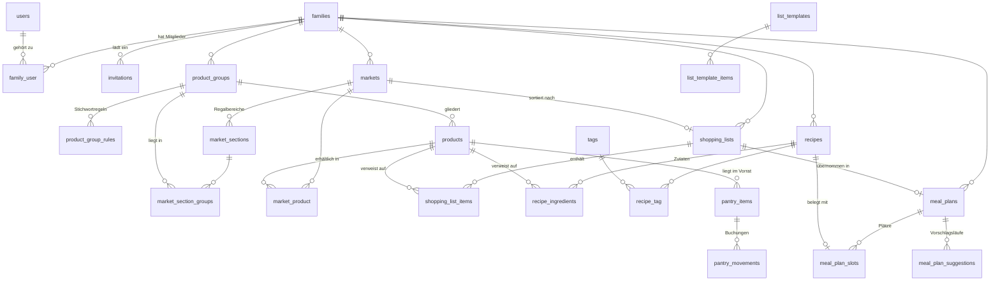

# Wocheneinkauf · Datenbankdokumentation

**Stand:** 13.08.2026 · **Schema:** `wocheneinkauf` · **35 Tabellen**

> Struktur, Typen, Schlüssel und Indizes dieses Dokuments sind aus `information_schema` erzeugt und können deshalb nicht von der laufenden Datenbank abweichen. Die Erläuterungen sind von Hand geschrieben.

---

## 1 · Konventionen

Wer eine Tabelle dieser Anwendung liest, findet immer dieselben Bauteile wieder. Sie einmal zu verstehen erspart es, sie siebenunddreißigmal nachzuschlagen.

### 1.1 Schlüssel

| Bauteil | Bedeutung |
|---|---|
| `id` | Fortlaufender Primärschlüssel, `bigint unsigned`. Bleibt **intern** -- er steht in keiner URL. |
| `public_id` | ULID (26 Zeichen, `ascii_bin`) für alles, was nach außen sichtbar wird. Aus einer laufenden Nummer ließe sich sonst ablesen, wie viele Familien oder Rezepte es gibt. |
| `family_id` | Der Mandant. Steht auf **jeder** fachlichen Tabelle -- ohne Ausnahme. |
| `client_uuid` | Vom Endgerät vergebene Kennung eines Listeneintrags. Macht wiederholtes Senden ungefährlich. |

### 1.2 Mandantentrennung auf drei Ebenen

Die Trennung der Familien ist die eine Eigenschaft, die nicht kaputtgehen darf. Deshalb hängt sie nicht an einer einzelnen Vorkehrung:

1. **Anwendung.** Ein Global Scope auf jedem Model hängt `where family_id = ?` an jede Abfrage. Wer das Filtern vergisst, bekommt trotzdem nur die eigenen Daten.
2. **Datenbank.** Verbund-Fremdschlüssel `(id, family_id)` statt einfacher Verweise: Ein Listeneintrag *kann* nicht in der Liste einer anderen Familie hängen, auch nicht durch einen Fehler im Code.
3. **Nachladen.** IDs aus Formularen werden nie direkt verwendet, sondern über den Global Scope neu geladen. Eine fremde ID trifft dann ins Leere, statt Daten zu verschieben.

Sichtbar wird Ebene 2 an den UNIQUE-Schlüsseln über `(id, family_id)`: Sie sehen überflüssig aus -- `id` ist schließlich schon eindeutig -- und sind es nicht. MySQL verlangt sie als Ziel für den Verbund-Fremdschlüssel.

### 1.3 Wiederkehrende Spalten

| Spalte | Bedeutung |
|---|---|
| `created_at`, `updated_at` | Vom Framework gepflegt. Fehlen bei Tabellen, die nur wachsen (Protokolle, Buchungen). |
| `deleted_at` | **Weiches Löschen.** Gesetzte Zeitmarke = gelöscht. Nötig für den Abgleich zwischen Geräten: Eine verschwundene Zeile wäre für das andere Gerät nicht von „noch nie gesehen" zu unterscheiden. |
| `sort` | Anzeigereihenfolge, kleinste Zahl zuerst. |
| `*_qty`, `amount` | `decimal(10,3)`. Kein Fließkomma: 0,1 + 0,2 soll 0,3 ergeben und nicht 0,30000000000000004. |

### 1.4 Regeln, die die Datenbank selbst durchsetzt

Zwei Zusagen der Anwendung stehen nicht im Code, sondern im Schema -- der Code könnte sie unter gleichzeitigen Zugriffen sonst verletzen:

| Regel | Umsetzung |
|---|---|
| Höchstens **eine aktive Einkaufsliste** je Familie | Generierte Spalte `shopping_lists.aktiv_marker` (1 bei `active`, sonst NULL) plus UNIQUE `(family_id, aktiv_marker)`. NULL zählt im UNIQUE nicht mit, deshalb sind beliebig viele archivierte Listen erlaubt. |
| Kein Eintrag in fremder Liste | Verbund-Fremdschlüssel `(list_id, family_id)` -- dasselbe Muster auf allen Untertabellen. |

---

## 2 · Die Tabellen im Überblick

| Gruppe | Tabellen |
|---|---|
| **Mandant, Konten und Zugang** | `families`, `users`, `family_user`, `family_settings`, `invitations`, `login_attempts`, `activity_log` |
| **Stammdaten** | `product_groups`, `product_group_rules`, `products`, `markets`, `market_sections`, `market_section_groups`, `market_product` |
| **Einkaufsliste** | `shopping_lists`, `shopping_list_items`, `list_templates`, `list_template_items` |
| **Rezepte** | `recipes`, `recipe_ingredients`, `tags`, `recipe_tag` |
| **Vorrat** | `pantry_items`, `pantry_movements` |
| **Wochenplan** | `meal_plans`, `meal_plan_slots`, `meal_plan_suggestions` |
| **Technische Tabellen des Frameworks** | `sessions`, `password_reset_tokens`, `cache`, `cache_locks`, `jobs`, `job_batches`, `failed_jobs`, `migrations` |

### 2.1 Beziehungen (ER-Diagramm)

Ohne die technischen Tabellen des Frameworks und ohne `family_id`, die an jeder fachlichen Tabelle hängt und das Bild sonst unlesbar machen würde.



---

## 3 · Die Tabellen im Einzelnen

### 3.1 Mandant, Konten und Zugang

Die Familie ist der Mandant. Jede fachliche Zeile der Anwendung trägt ihre `family_id` -- ohne Ausnahme. Nutzer hängen nicht an einer Familie, sondern an beliebig vielen; welche gerade gilt, steht in `users.current_family_id`.

#### `families`

Der Mandant. Eine Familie entsteht bei der Registrierung mit; sie wird nie „nebenbei" angelegt.

| Spalte | Typ | Null | Vorgabe | Erläuterung |
|---|---|:---:|---|---|
| `id` | `bigint(20) unsigned` | — | — |  |
| `public_id` | `char(26)` | — | — | ULID für URLs. Die laufende `id` bleibt intern -- aus ihr ließe sich ablesen, wie viele Familien es gibt. |
| `name` | `varchar(120)` | — | — |  |
| `locale` | `varchar(10)` | — | `'de_DE'` |  |
| `timezone` | `varchar(64)` | — | `'Europe/Berlin'` |  |
| `week_starts_on` | `tinyint(3) unsigned` | — | `6` | Erster Tag der Planwoche, 1 = Montag … 7 = Sonntag. Voreingestellt ist **6 (Samstag)**, weil an dem Tag eingekauft wird. Der Wochenplan rechnet damit. |
| `status` | `enum('active','suspended','deleted')` | — | `'active'` | Gesperrte Familien bleiben lesbar, aber unveränderlich. |
| `created_at` | `timestamp` | ja | `NULL` |  |
| `updated_at` | `timestamp` | ja | `NULL` |  |
| `deleted_at` | `timestamp` | ja | `NULL` | Weiches Löschen: Eine gelöschte Familie ist für die Anwendung weg, für die Wiederherstellung noch da. |

*Schlüssel und Indizes:* **UNIQUE** (`public_id`) · **Primärschlüssel** (`id`)

> `locale` und `timezone` stehen hier und nicht am Nutzer, weil eine Einkaufsliste nur in *einer* Zeitzone Sinn ergibt.

#### `users`

Konten. Ein Konto kann mehreren Familien angehören -- Patchwork ist der Normalfall, nicht die Ausnahme.

| Spalte | Typ | Null | Vorgabe | Erläuterung |
|---|---|:---:|---|---|
| `id` | `bigint(20) unsigned` | — | — |  |
| `public_id` | `char(26)` | — | — |  |
| `name` | `varchar(120)` | — | — |  |
| `email` | `varchar(190)` | — | — |  |
| `email_verified_at` | `timestamp` | ja | `NULL` | Ohne Bestätigung ist keine Seite erreichbar. |
| `password` | `varchar(255)` | — | — | Nur der Hash (bcrypt). Das Klartextpasswort existiert an keiner Stelle des Systems. |
| `remember_token` | `varchar(100)` | ja | `NULL` |  |
| `current_family_id` | `bigint(20) unsigned` | ja | `NULL` | In welcher Familie der Nutzer gerade arbeitet. Der Global Scope liest genau diesen Wert; ohne ihn sieht die Anwendung nichts. |
| `locale` | `varchar(10)` | — | `'de_DE'` |  |
| `last_login_at` | `timestamp` | ja | `NULL` |  |
| `created_at` | `timestamp` | ja | `NULL` |  |
| `updated_at` | `timestamp` | ja | `NULL` |  |
| `deleted_at` | `timestamp` | ja | `NULL` |  |

*Schlüssel und Indizes:* **Primärschlüssel** (`id`) · **Index** (`current_family_id`) · **UNIQUE** (`email`) · **UNIQUE** (`public_id`)

*Fremdschlüssel:* (`current_family_id`) → `families`  beim Löschen: set null

> `email` ist global eindeutig, nicht je Familie -- ein Mensch, ein Konto.

#### `family_user`

Die Mitgliedschaft samt Rolle. Verbundschlüssel aus `family_id` und `user_id`, keine eigene ID.

| Spalte | Typ | Null | Vorgabe | Erläuterung |
|---|---|:---:|---|---|
| `family_id` | `bigint(20) unsigned` | — | — |  |
| `user_id` | `bigint(20) unsigned` | — | — |  |
| `role` | `enum('owner','admin','member','child')` | — | `'member'` | `owner` darf alles einschließlich Löschen der Familie; `admin` pflegt Struktur (Warengruppen, Märkte, Regalbereiche); `member` pflegt Alltagsdaten; `child` liest und hakt ab. |
| `joined_at` | `timestamp` | — | `current_timestamp()` |  |

*Schlüssel und Indizes:* **Index** (`user_id`) · **Primärschlüssel** (`family_id`, `user_id`)

*Fremdschlüssel:* (`family_id`) → `families`  beim Löschen: cascade · (`user_id`) → `users`  beim Löschen: cascade

> Der letzte Owner einer Familie kann nicht entfernt werden -- sonst gäbe es Daten ohne Zuständige.

#### `family_settings`

Freie Einstellungen je Familie als Schlüssel-Wert-Paare. Für alles, was keine eigene Spalte verdient.

| Spalte | Typ | Null | Vorgabe | Erläuterung |
|---|---|:---:|---|---|
| `family_id` | `bigint(20) unsigned` | — | — |  |
| `setting_key` | `varchar(80)` | — | — | Heißt nicht `key`, weil das in MySQL ein reserviertes Wort ist. |
| `value` | `longtext` | — | — |  |
| `updated_at` | `timestamp` | — | `current_timestamp()` |  |

*Schlüssel und Indizes:* **Primärschlüssel** (`family_id`, `setting_key`)

*Fremdschlüssel:* (`family_id`) → `families`  beim Löschen: cascade

#### `invitations`

Einladungen in eine Familie. Der Link funktioniert auch für Gäste ohne Konto -- wer eingeladen wird, hat in der Regel noch keines.

| Spalte | Typ | Null | Vorgabe | Erläuterung |
|---|---|:---:|---|---|
| `id` | `bigint(20) unsigned` | — | — |  |
| `family_id` | `bigint(20) unsigned` | — | — |  |
| `email` | `varchar(190)` | ja | `NULL` |  |
| `role` | `enum('admin','member','child')` | — | `'member'` |  |
| `token_hash` | `char(64)` | — | — | Nur der Hash liegt in der Datenbank. Wer sie liest, kann damit keine Einladung einlösen. |
| `invited_by` | `bigint(20) unsigned` | ja | `NULL` |  |
| `max_uses` | `smallint(5) unsigned` | — | `1` | Erlaubt eine Einladung für mehrere Personen, etwa einen Familien-Link. |
| `used_count` | `smallint(5) unsigned` | — | `0` |  |
| `expires_at` | `timestamp` | — | — |  |
| `revoked_at` | `timestamp` | ja | `NULL` | Zurückgezogene Einladungen bleiben stehen -- die Frage „wer hat wen eingeladen" muss beantwortbar bleiben. |
| `created_at` | `timestamp` | ja | `NULL` |  |

*Schlüssel und Indizes:* **Index** (`family_id`) · **Index** (`invited_by`) · **UNIQUE** (`token_hash`) · **Primärschlüssel** (`id`)

*Fremdschlüssel:* (`family_id`) → `families`  beim Löschen: cascade · (`invited_by`) → `users`  beim Löschen: set null

#### `login_attempts`

Anmeldeversuche für die Sperre nach zu vielen Fehlschlägen.

| Spalte | Typ | Null | Vorgabe | Erläuterung |
|---|---|:---:|---|---|
| `id` | `bigint(20) unsigned` | — | — |  |
| `email` | `varchar(190)` | — | — |  |
| `ip_address` | `varbinary(16)` | ja | `NULL` | `varbinary(16)`, damit auch IPv6 hineinpasst -- gespeichert wird die gepackte Form. |
| `successful` | `tinyint(1)` | — | `0` |  |
| `attempted_at` | `timestamp` | — | `current_timestamp()` |  |

*Schlüssel und Indizes:* **Index** (`email`, `attempted_at`) · **Index** (`ip_address`, `attempted_at`) · **Primärschlüssel** (`id`)

> Die Tabelle wird regelmäßig aufgeräumt; sie ist eine Sperrliste, kein Protokoll.

#### `activity_log`

Was in einer Familie geschehen ist. Beantwortet im Alltag vor allem eine Frage: „Wer hat das gelöscht?"

| Spalte | Typ | Null | Vorgabe | Erläuterung |
|---|---|:---:|---|---|
| `id` | `bigint(20) unsigned` | — | — |  |
| `family_id` | `bigint(20) unsigned` | ja | `NULL` |  |
| `user_id` | `bigint(20) unsigned` | ja | `NULL` |  |
| `action` | `varchar(60)` | — | — |  |
| `subject_type` | `varchar(60)` | ja | `NULL` | Kurzname statt vollem Klassennamen -- ein Protokoll soll eine Umbenennung im Code überleben. |
| `subject_id` | `bigint(20) unsigned` | ja | `NULL` |  |
| `meta` | `longtext` | ja | `NULL` | JSON mit dem, was zum Vorgang gehört. Bewusst formlos: Ein Protokoll, das ein Schema erzwingt, wird beim nächsten Feature unvollständig. |
| `created_at` | `timestamp` | — | `current_timestamp()` |  |

*Schlüssel und Indizes:* **Index** (`family_id`, `created_at`) · **Primärschlüssel** (`id`)

### 3.2 Stammdaten

Warengruppen gliedern alles, Märkte bestimmen die Reihenfolge im Laden, und der Artikelkatalog ist die gemeinsame Klammer von Einkaufsliste, Rezept und Vorrat.

#### `product_groups`

Warengruppen -- die Gliederung von Liste, Katalog und Regalbereichen. Bei der Registrierung entstehen 15 Stück als Startdatensatz.

| Spalte | Typ | Null | Vorgabe | Erläuterung |
|---|---|:---:|---|---|
| `id` | `bigint(20) unsigned` | — | — |  |
| `family_id` | `bigint(20) unsigned` | — | — |  |
| `code` | `varchar(32)` | — | — | Sprechender Schlüssel (`OBST_GEMUESE`). Regeln und Startdaten verweisen darauf, nicht auf die ID. |
| `label` | `varchar(80)` | — | — |  |
| `sort` | `smallint(5) unsigned` | — | `0` | Reihenfolge ohne gewählten Markt. |
| `created_at` | `timestamp` | ja | `NULL` |  |
| `updated_at` | `timestamp` | ja | `NULL` |  |

*Schlüssel und Indizes:* **Primärschlüssel** (`id`) · **UNIQUE** (`family_id`, `code`) · **UNIQUE** (`id`, `family_id`)

*Fremdschlüssel:* (`family_id`) → `families`  beim Löschen: cascade

#### `product_group_rules`

Stichwortregeln der automatischen Einsortierung (B-07): „milch" → Molkereiprodukte. Rund 90 Regeln je Familie im Startdatensatz.

| Spalte | Typ | Null | Vorgabe | Erläuterung |
|---|---|:---:|---|---|
| `id` | `bigint(20) unsigned` | — | — |  |
| `family_id` | `bigint(20) unsigned` | — | — |  |
| `product_group_id` | `bigint(20) unsigned` | — | — |  |
| `pattern` | `varchar(120)` | — | — | Suchbegriff oder regulärer Ausdruck, je nach `is_regex`. |
| `is_regex` | `tinyint(1)` | — | `0` |  |
| `priority` | `smallint(5) unsigned` | — | `100` | Kleinste Zahl gewinnt. Getränkeregeln stehen vor den Obstregeln, sonst landet Apfelsaft im Obst. |

*Schlüssel und Indizes:* **Primärschlüssel** (`id`) · **Index** (`family_id`, `priority`) · **Index** (`product_group_id`)

*Fremdschlüssel:* (`family_id`) → `families`  beim Löschen: cascade · (`product_group_id`) → `product_groups`  beim Löschen: cascade

> Die Regeln gehören der Familie: Wer „Bowle" beim Alkohol haben will, ändert das für sich und nicht für alle.

#### `products`

Der Artikelkatalog. Er ist die gemeinsame Klammer: Ein Listeneintrag, eine Rezeptzutat und eine Vorratsposition zeigen auf denselben Artikel.

| Spalte | Typ | Null | Vorgabe | Erläuterung |
|---|---|:---:|---|---|
| `id` | `bigint(20) unsigned` | — | — |  |
| `family_id` | `bigint(20) unsigned` | — | — |  |
| `name` | `varchar(160)` | — | — |  |
| `name_normalized` | `varchar(160)` | — | — | Kleingeschrieben, ohne Umlaute und Sonderzeichen. Darüber laufen Suche und Zusammenführung -- „Äpfel" und „aepfel" sind derselbe Artikel. |
| `product_group_id` | `bigint(20) unsigned` | ja | `NULL` |  |
| `default_unit` | `varchar(20)` | ja | `NULL` |  |
| `is_pantry_staple` | `tinyint(1)` | — | `0` | Gehört zum Grundvorrat: Was immer im Haus sein soll. |
| `pantry_target_amount` | `decimal(10,3)` | ja | `NULL` | Sollmenge des Grundvorrats. Kam bei der Zusammenführung von „Fixartikel" und „Grundvorrat" aus der abgeschafften Tabelle `standing_items` hierher. |
| `created_at` | `timestamp` | ja | `NULL` |  |
| `updated_at` | `timestamp` | ja | `NULL` |  |
| `deleted_at` | `timestamp` | ja | `NULL` | Weiches Löschen, weil alte Listen und Rezepte weiter auf den Artikel zeigen. |

*Schlüssel und Indizes:* **Primärschlüssel** (`id`) · **UNIQUE** (`family_id`, `name_normalized`) · **UNIQUE** (`id`, `family_id`) · **Index** (`product_group_id`)

*Fremdschlüssel:* (`family_id`) → `families`  beim Löschen: cascade · (`product_group_id`) → `product_groups`  beim Löschen: set null

#### `markets`

Die Märkte der Familie. Einer ist Standard und wird für neue Listen vorgeschlagen.

| Spalte | Typ | Null | Vorgabe | Erläuterung |
|---|---|:---:|---|---|
| `id` | `bigint(20) unsigned` | — | — |  |
| `family_id` | `bigint(20) unsigned` | — | — |  |
| `name` | `varchar(80)` | — | — |  |
| `sort` | `smallint(5) unsigned` | — | `0` |  |
| `is_default` | `tinyint(1)` | — | `0` | Höchstens einer je Familie -- die Anwendung setzt den bisherigen zurück, wenn ein neuer bestimmt wird. |
| `is_active` | `tinyint(1)` | — | `1` | Ein stillgelegter Markt verschwindet aus der Auswahl, bleibt aber an den archivierten Listen erhalten. |
| `created_at` | `timestamp` | ja | `NULL` |  |
| `updated_at` | `timestamp` | ja | `NULL` |  |

*Schlüssel und Indizes:* **UNIQUE** (`family_id`, `name`) · **UNIQUE** (`id`, `family_id`) · **Primärschlüssel** (`id`)

*Fremdschlüssel:* (`family_id`) → `families`  beim Löschen: cascade

#### `market_sections`

Regalbereiche in **Laufreihenfolge**. Sie sind der Grund, warum die Liste im Laden von oben nach unten abgearbeitet werden kann.

| Spalte | Typ | Null | Vorgabe | Erläuterung |
|---|---|:---:|---|---|
| `id` | `bigint(20) unsigned` | — | — |  |
| `family_id` | `bigint(20) unsigned` | — | — |  |
| `market_id` | `bigint(20) unsigned` | — | — |  |
| `name` | `varchar(120)` | — | — |  |
| `sort` | `smallint(5) unsigned` | — | `0` | Die Reihenfolge, in der man durch den Laden geht -- nicht die alphabetische. |

*Schlüssel und Indizes:* **Index** (`family_id`) · **UNIQUE** (`id`, `family_id`) · **UNIQUE** (`market_id`, `name`) · **Index** (`market_id`, `sort`) · **Primärschlüssel** (`id`)

*Fremdschlüssel:* (`family_id`) → `families`  beim Löschen: cascade · (`market_id`) → `markets`  beim Löschen: cascade

#### `market_section_groups`

Welche Warengruppe in welchem Regalbereich liegt. Dieselbe Gruppe darf in mehreren Märkten unterschiedlich einsortiert sein.

| Spalte | Typ | Null | Vorgabe | Erläuterung |
|---|---|:---:|---|---|
| `family_id` | `bigint(20) unsigned` | — | — |  |
| `market_section_id` | `bigint(20) unsigned` | — | — |  |
| `product_group_id` | `bigint(20) unsigned` | — | — |  |

*Schlüssel und Indizes:* **Index** (`market_section_id`, `family_id`) · **Index** (`product_group_id`, `family_id`) · **Primärschlüssel** (`market_section_id`, `product_group_id`)

*Fremdschlüssel:* (`product_group_id`, `family_id`) → `product_groups`  *(Verbund)* beim Löschen: cascade · (`market_section_id`, `family_id`) → `market_sections`  *(Verbund)* beim Löschen: cascade

> Reine Zuordnungstabelle mit Verbundschlüssel, keine eigene ID.

#### `market_product`

Wo es einen Artikel überhaupt gibt (Misopaste nur im Asialaden).

| Spalte | Typ | Null | Vorgabe | Erläuterung |
|---|---|:---:|---|---|
| `family_id` | `bigint(20) unsigned` | — | — |  |
| `market_id` | `bigint(20) unsigned` | — | — |  |
| `product_id` | `bigint(20) unsigned` | — | — |  |

*Schlüssel und Indizes:* **Index** (`family_id`) · **Index** (`market_id`, `family_id`) · **Index** (`product_id`, `family_id`) · **Primärschlüssel** (`market_id`, `product_id`)

*Fremdschlüssel:* (`family_id`) → `families`  beim Löschen: cascade · (`market_id`, `family_id`) → `markets`  *(Verbund)* beim Löschen: cascade · (`product_id`, `family_id`) → `products`  *(Verbund)* beim Löschen: cascade

> **Keine Zeile heißt: überall erhältlich.** Das ist der häufige Fall, und der soll keine Pflege kosten. Erst wer Zeilen anlegt, schränkt ein.

> Artikel, die es im gewählten Markt nicht gibt, sammelt die Liste am Ende unter „Gibt es hier nicht".

### 3.3 Einkaufsliste

Je Familie gibt es höchstens **eine** aktive Liste -- das erzwingt die Datenbank und nicht die Anwendung. Alles Weitere ist Archiv.

#### `shopping_lists`

Eine Liste je Einkauf. Die aktive ist die, auf die geschrieben wird; alles andere ist Archiv.

| Spalte | Typ | Null | Vorgabe | Erläuterung |
|---|---|:---:|---|---|
| `id` | `bigint(20) unsigned` | — | — |  |
| `public_id` | `char(26)` | — | — |  |
| `family_id` | `bigint(20) unsigned` | — | — |  |
| `name` | `varchar(120)` | ja | `NULL` |  |
| `market_id` | `bigint(20) unsigned` | ja | `NULL` |  |
| `status` | `enum('active','archived')` | — | `'active'` |  |
| `version` | `int(10) unsigned` | — | `1` | Zähler für den Abgleich zwischen Geräten. Wer mit einer veralteten Version schreibt, bekommt 409 und den aktuellen Stand -- statt fremde Änderungen zu überschreiben. |
| `archived_at` | `timestamp` | ja | `NULL` | Zeitpunkt des Einkaufsabschlusses. |
| `created_by` | `bigint(20) unsigned` | ja | `NULL` |  |
| `created_at` | `timestamp` | ja | `NULL` |  |
| `updated_at` | `timestamp` | ja | `NULL` |  |
| `aktiv_marker` | `tinyint(3) unsigned` | ja | *berechnet* | Generierte Spalte: 1 bei `status = active`, sonst NULL. Zusammen mit dem UNIQUE über (`family_id`, `aktiv_marker`) erzwingt sie **höchstens eine aktive Liste je Familie**. NULL-Werte zählen im UNIQUE nicht mit -- deshalb dürfen beliebig viele Listen archiviert sein. |

*Schlüssel und Indizes:* **Primärschlüssel** (`id`) · **Index** (`created_by`) · **UNIQUE** (`family_id`, `aktiv_marker`) · **Index** (`family_id`, `status`, `archived_at`) · **UNIQUE** (`id`, `family_id`) · **Index** (`market_id`) · **UNIQUE** (`public_id`)

*Fremdschlüssel:* (`created_by`) → `users`  beim Löschen: set null · (`family_id`) → `families`  beim Löschen: cascade · (`market_id`) → `markets`  beim Löschen: set null

> Die Regel „eine aktive Liste" steht in der Datenbank und nicht nur im Code. Zwei gleichzeitige Anfragen können sie so nicht aushebeln.

#### `shopping_list_items`

Die Einträge der Liste -- das Herzstück der Anwendung.

| Spalte | Typ | Null | Vorgabe | Erläuterung |
|---|---|:---:|---|---|
| `id` | `bigint(20) unsigned` | — | — |  |
| `family_id` | `bigint(20) unsigned` | — | — |  |
| `list_id` | `bigint(20) unsigned` | — | — |  |
| `client_uuid` | `char(36)` | — | — | Vom Gerät vergeben. Damit ist dieselbe Änderung beliebig oft sendbar, ohne doppelt anzukommen; nach einem Verbindungsabbruch ist genau das der Normalfall. |
| `product_id` | `bigint(20) unsigned` | ja | `NULL` |  |
| `raw_name` | `varchar(160)` | — | — | Der Name, wie er auf der Liste steht. |
| `amount` | `decimal(10,3)` | ja | `NULL` | Zahlenwert für das Zusammenrechnen. |
| `amount_raw` | `varchar(20)` | ja | `NULL` | Die Eingabe im Original („1-2"). Sie bleibt erhalten, weil sich nicht jede Mengenangabe in eine Zahl pressen lässt. |
| `unit` | `varchar(20)` | ja | `NULL` |  |
| `note` | `varchar(160)` | ja | `NULL` |  |
| `product_group_id` | `bigint(20) unsigned` | ja | `NULL` |  |
| `is_checked` | `tinyint(1)` | — | `0` |  |
| `checked_by` | `bigint(20) unsigned` | ja | `NULL` |  |
| `checked_at` | `timestamp` | ja | `NULL` |  |
| `source` | `enum('manual','recipe','pantry','standing','mealplan','template')` | — | `'manual'` | Woher der Eintrag kommt: von Hand, aus einem Rezept, aus dem Vorrat, aus einer Vorlage oder aus dem Wochenplan. |
| `source_ref_id` | `bigint(20) unsigned` | ja | `NULL` | Der Verweis dazu -- Rezept-ID, Vorratsposition, Inventurlauf. |
| `sort` | `int(10) unsigned` | — | `0` |  |
| `created_at` | `timestamp` | ja | `NULL` |  |
| `updated_at` | `timestamp` | ja | `NULL` |  |
| `deleted_at` | `timestamp` | ja | `NULL` | Weiches Löschen, damit der Abgleich Löschungen überhaupt mitbekommt. Eine verschwundene Zeile wäre für das andere Gerät nicht von „noch nie gesehen" zu unterscheiden. |

*Schlüssel und Indizes:* **Primärschlüssel** (`id`) · **Index** (`checked_by`) · **Index** (`family_id`, `client_uuid`) · **Index** (`family_id`, `updated_at`) · **UNIQUE** (`list_id`, `client_uuid`) · **Index** (`list_id`, `family_id`) · **Index** (`list_id`, `is_checked`, `sort`) · **Index** (`product_group_id`) · **Index** (`product_id`)

*Fremdschlüssel:* (`checked_by`) → `users`  beim Löschen: set null · (`family_id`) → `families`  beim Löschen: cascade · (`list_id`, `family_id`) → `shopping_lists`  *(Verbund)* beim Löschen: cascade · (`product_group_id`) → `product_groups`  beim Löschen: set null · (`product_id`) → `products`  beim Löschen: set null

> Zusammengeführte Einträge bleiben als gelöschte Zeile stehen („Grabstein"), damit ein wiederholtes Senden nicht doch noch eine zweite Zeile erzeugt.

> Der Verbundschlüssel (`list_id`, `family_id`) verhindert, dass ein Eintrag in der Liste einer anderen Familie landet -- selbst bei einem Fehler in der Anwendung.

#### `list_templates`

Vorlagen für neue Listen: „Wocheneinkauf", „Grillabend". Höchstens eine ist Standard.

| Spalte | Typ | Null | Vorgabe | Erläuterung |
|---|---|:---:|---|---|
| `id` | `bigint(20) unsigned` | — | — |  |
| `public_id` | `char(26)` | — | — |  |
| `family_id` | `bigint(20) unsigned` | — | — |  |
| `name` | `varchar(120)` | — | — |  |
| `description` | `varchar(255)` | ja | `NULL` |  |
| `is_default` | `tinyint(1)` | — | `0` |  |
| `sort` | `smallint(5) unsigned` | — | `0` |  |
| `created_at` | `timestamp` | ja | `NULL` |  |
| `updated_at` | `timestamp` | ja | `NULL` |  |

*Schlüssel und Indizes:* **UNIQUE** (`family_id`, `name`) · **UNIQUE** (`id`, `family_id`) · **UNIQUE** (`public_id`) · **Primärschlüssel** (`id`)

*Fremdschlüssel:* (`family_id`) → `families`  beim Löschen: cascade

#### `list_template_items`

Die Positionen einer Vorlage. Aufbau wie ein Listeneintrag, ohne Haken und ohne Abgleich.

| Spalte | Typ | Null | Vorgabe | Erläuterung |
|---|---|:---:|---|---|
| `id` | `bigint(20) unsigned` | — | — |  |
| `family_id` | `bigint(20) unsigned` | — | — |  |
| `template_id` | `bigint(20) unsigned` | — | — |  |
| `product_id` | `bigint(20) unsigned` | ja | `NULL` |  |
| `raw_name` | `varchar(160)` | — | — |  |
| `amount` | `decimal(10,3)` | ja | `NULL` |  |
| `amount_raw` | `varchar(20)` | ja | `NULL` |  |
| `unit` | `varchar(20)` | ja | `NULL` |  |
| `note` | `varchar(160)` | ja | `NULL` |  |
| `product_group_id` | `bigint(20) unsigned` | ja | `NULL` |  |
| `sort` | `int(10) unsigned` | — | `0` |  |
| `created_at` | `timestamp` | ja | `NULL` |  |
| `updated_at` | `timestamp` | ja | `NULL` |  |

*Schlüssel und Indizes:* **Index** (`family_id`) · **Index** (`product_group_id`) · **Index** (`product_id`) · **Index** (`template_id`, `family_id`) · **Index** (`template_id`, `sort`) · **Primärschlüssel** (`id`)

*Fremdschlüssel:* (`family_id`) → `families`  beim Löschen: cascade · (`product_group_id`) → `product_groups`  beim Löschen: set null · (`product_id`) → `products`  beim Löschen: set null · (`template_id`, `family_id`) → `list_templates`  *(Verbund)* beim Löschen: cascade

### 3.4 Rezepte

Rezepte mit Zutaten und Schlagworten. Die Zutat kennt drei Namen: den Originaltext, den Einkaufsnamen und den Sammelbegriff -- daran hängt die Übernahme auf die Einkaufsliste.

#### `recipes`

Rezepte mit Zubereitung, Nährwerten und Aufwand.

| Spalte | Typ | Null | Vorgabe | Erläuterung |
|---|---|:---:|---|---|
| `id` | `bigint(20) unsigned` | — | — |  |
| `public_id` | `char(26)` | — | — |  |
| `family_id` | `bigint(20) unsigned` | — | — |  |
| `name` | `varchar(200)` | — | — |  |
| `slug` | `varchar(220)` | — | — | Je Familie eindeutig. Bei Namensgleichheit hängt das Model eine Zahl an, statt den UNIQUE-Fehler bis in die Oberfläche durchschlagen zu lassen. |
| `servings` | `smallint(5) unsigned` | — | `4` |  |
| `prep_minutes` | `smallint(5) unsigned` | ja | `NULL` |  |
| `cook_minutes` | `smallint(5) unsigned` | ja | `NULL` |  |
| `effort` | `enum('quick','normal','elaborate')` | — | `'normal'` | Steuert den Wochenplan: `quick` werktags, `elaborate` am Wochenende. |
| `instructions` | `mediumtext` | ja | `NULL` |  |
| `notes` | `text` | ja | `NULL` |  |
| `nutrition` | `longtext` | ja | `NULL` | JSON, weil Nährwertangaben je Quelle anders aussehen. |
| `plant_points` | `tinyint(3) unsigned` | — | `0` | Wie viele verschiedene Pflanzen im Gericht stecken. Fließt in die Bewertung des Vorschlagsgenerators ein. |
| `is_favorite` | `tinyint(1)` | — | `0` |  |
| `exclude_from_suggestions` | `tinyint(1)` | — | `0` | „Nie vorschlagen" (F-15). Von Hand einsetzen bleibt erlaubt -- der Ausschluss gilt nur dem Generator. |
| `source_url` | `varchar(500)` | ja | `NULL` |  |
| `created_by` | `bigint(20) unsigned` | ja | `NULL` |  |
| `created_at` | `timestamp` | ja | `NULL` |  |
| `updated_at` | `timestamp` | ja | `NULL` |  |
| `deleted_at` | `timestamp` | ja | `NULL` |  |

*Schlüssel und Indizes:* **Primärschlüssel** (`id`) · **Index** (`created_by`) · **Index** (`family_id`, `name`) · **UNIQUE** (`family_id`, `slug`) · **UNIQUE** (`id`, `family_id`) · **UNIQUE** (`public_id`)

*Fremdschlüssel:* (`created_by`) → `users`  beim Löschen: set null · (`family_id`) → `families`  beim Löschen: cascade

#### `recipe_ingredients`

Die Zutaten. Drei Namensfelder, und jedes hat seinen Grund.

| Spalte | Typ | Null | Vorgabe | Erläuterung |
|---|---|:---:|---|---|
| `id` | `bigint(20) unsigned` | — | — |  |
| `family_id` | `bigint(20) unsigned` | — | — |  |
| `recipe_id` | `bigint(20) unsigned` | — | — |  |
| `product_id` | `bigint(20) unsigned` | ja | `NULL` |  |
| `raw_name` | `varchar(200)` | — | — | Der Originaltext aus dem Rezept. |
| `amount` | `decimal(10,3)` | ja | `NULL` | Darf leer sein: „etwas Petersilie" bleibt beim Skalieren „etwas Petersilie" und wird nicht zu „1,5 etwas". |
| `unit` | `varchar(20)` | ja | `NULL` |  |
| `is_pantry` | `tinyint(1)` | — | `0` | Vorratszutat -- in der Übernahmemaske vorab **abgewählt**. Was im Schrank steht, muss nicht mit. |
| `buy_label` | `varchar(160)` | ja | `NULL` | Was auf der Einkaufsliste stehen soll, wenn es abweicht: Zutat „Olivenöl", auf der Liste „Olivenöl, gutes fürs Dressing". |
| `merge_key` | `varchar(60)` | ja | `NULL` | Klammert Zutaten, die aus mehreren Rezepten zu einem Listeneintrag zusammenfallen sollen. |
| `is_optional` | `tinyint(1)` | — | `0` | „Nach Belieben". Zählt bei der Vorratsdeckung des Wochenplans nicht mit. |
| `sort` | `smallint(5) unsigned` | — | `0` |  |

*Schlüssel und Indizes:* **Primärschlüssel** (`id`) · **Index** (`family_id`) · **Index** (`product_id`) · **Index** (`recipe_id`, `family_id`) · **Index** (`recipe_id`, `sort`)

*Fremdschlüssel:* (`family_id`) → `families`  beim Löschen: cascade · (`product_id`) → `products`  beim Löschen: set null · (`recipe_id`, `family_id`) → `recipes`  *(Verbund)* beim Löschen: cascade

#### `tags`

Schlagworte mit Art. Der Typ ist nicht Kosmetik: Der Vorschlagsgenerator liest `protein` und `cuisine` für die Abwechslung.

| Spalte | Typ | Null | Vorgabe | Erläuterung |
|---|---|:---:|---|---|
| `id` | `bigint(20) unsigned` | — | — |  |
| `family_id` | `bigint(20) unsigned` | — | — |  |
| `type` | `enum('protein','cuisine','diet','course','season','other')` | — | `'other'` |  |
| `name` | `varchar(60)` | — | — |  |

*Schlüssel und Indizes:* **Primärschlüssel** (`id`) · **UNIQUE** (`family_id`, `type`, `name`) · **UNIQUE** (`id`, `family_id`)

*Fremdschlüssel:* (`family_id`) → `families`  beim Löschen: cascade

#### `recipe_tag`

Zuordnung Rezept ↔ Schlagwort.

| Spalte | Typ | Null | Vorgabe | Erläuterung |
|---|---|:---:|---|---|
| `family_id` | `bigint(20) unsigned` | — | — |  |
| `recipe_id` | `bigint(20) unsigned` | — | — |  |
| `tag_id` | `bigint(20) unsigned` | — | — |  |

*Schlüssel und Indizes:* **Primärschlüssel** (`recipe_id`, `tag_id`) · **Index** (`recipe_id`, `family_id`) · **Index** (`tag_id`, `family_id`)

*Fremdschlüssel:* (`recipe_id`, `family_id`) → `recipes`  *(Verbund)* beim Löschen: cascade · (`tag_id`, `family_id`) → `tags`  *(Verbund)* beim Löschen: cascade

### 3.5 Vorrat

Der Grundvorrat am Artikel ist die *Absicht* (`products.pantry_target_amount`), `pantry_items` ist die *Wirklichkeit*: was tatsächlich wo liegt. Jede Änderung daran ist eine Buchung. Gezählt wird über die Bestandsaufnahme, die ohne eigene Tabellen auskommt -- ihr Ergebnis ist die Einkaufsliste.

#### `pantry_items`

Was tatsächlich im Haus ist. Derselbe Artikel darf an mehreren Orten liegen -- Nudeln in der Speisekammer *und* im Keller.

| Spalte | Typ | Null | Vorgabe | Erläuterung |
|---|---|:---:|---|---|
| `id` | `bigint(20) unsigned` | — | — |  |
| `family_id` | `bigint(20) unsigned` | — | — |  |
| `product_id` | `bigint(20) unsigned` | — | — |  |
| `location` | `varchar(80)` | — | `'Vorrat'` | Der Ort. Teil des Eindeutigkeitsschlüssels, deshalb mit Vorgabe „Vorrat" statt NULL. |
| `unit` | `varchar(20)` | ja | `NULL` |  |
| `target_qty` | `decimal(10,3)` | — | `1.000` | Sollmenge: so viel soll da sein. |
| `min_qty` | `decimal(10,3)` | — | `0.000` | Meldebestand: darunter wird es knapp. |
| `current_qty` | `decimal(10,3)` | — | `0.000` | Der laufende Bestand. Wird ausschließlich über Buchungen verändert und nie unter null geführt. |
| `best_before` | `date` | ja | `NULL` | Haltbarkeitsdatum. Der Wochenplan zieht Gerichte vor, deren Zutaten bald ablaufen. |
| `is_active` | `tinyint(1)` | — | `1` |  |
| `sort` | `smallint(5) unsigned` | — | `0` |  |
| `counted_at` | `timestamp` | ja | `NULL` |  |
| `created_at` | `timestamp` | ja | `NULL` |  |
| `updated_at` | `timestamp` | ja | `NULL` |  |

*Schlüssel und Indizes:* **Index** (`family_id`, `is_active`, `sort`) · **UNIQUE** (`family_id`, `product_id`, `location`) · **UNIQUE** (`id`, `family_id`) · **Index** (`product_id`, `family_id`) · **Primärschlüssel** (`id`)

*Fremdschlüssel:* (`family_id`) → `families`  beim Löschen: cascade · (`product_id`, `family_id`) → `products`  *(Verbund)* beim Löschen: cascade

#### `pantry_movements`

Jede Bestandsänderung als eigene Zeile. Kostet Platz und beantwortet dafür die Frage, wo die Vorräte geblieben sind.

| Spalte | Typ | Null | Vorgabe | Erläuterung |
|---|---|:---:|---|---|
| `id` | `bigint(20) unsigned` | — | — |  |
| `family_id` | `bigint(20) unsigned` | — | — |  |
| `pantry_item_id` | `bigint(20) unsigned` | — | — |  |
| `qty_delta` | `decimal(10,3)` | — | — | Die Änderung, nicht der neue Stand. Gebucht wird, was **tatsächlich** passiert ist: Wer 3 kg verbraucht, aber nur 2 kg im System hatte, erzeugt −2 und nicht −3. Sonst summieren sich die Bewegungen nicht mehr zum Bestand. |
| `reason` | `enum('purchase','consumption','inventory','correction','expired')` | — | — | Zugang, Verbrauch, Korrektur, Verfall. Der Wert `inventory` stammt aus dem entfernten Inventurlauf und wird nicht mehr vergeben -- er bleibt im Aufzählungstyp, weil alte Buchungen ihn tragen könnten. |
| `ref_type` | `varchar(40)` | ja | `NULL` | Auslöser einer Buchung, sofern sie nicht von Hand kam. |
| `ref_id` | `bigint(20) unsigned` | ja | `NULL` |  |
| `created_by` | `bigint(20) unsigned` | ja | `NULL` |  |
| `created_at` | `timestamp` | — | `current_timestamp()` |  |

*Schlüssel und Indizes:* **Index** (`created_by`) · **Index** (`family_id`, `created_at`) · **Index** (`pantry_item_id`, `created_at`) · **Index** (`pantry_item_id`, `family_id`) · **Primärschlüssel** (`id`)

*Fremdschlüssel:* (`created_by`) → `users`  beim Löschen: set null · (`family_id`) → `families`  beim Löschen: cascade · (`pantry_item_id`, `family_id`) → `pantry_items`  *(Verbund)* beim Löschen: cascade

### 3.6 Wochenplan

Ein Plan je Familie und Woche, sieben Tage als feste Plätze. Leere Plätze sind Datensätze und keine Lücken -- nur so lassen sie sich sperren und einzeln neu würfeln.

#### `meal_plans`

Ein Plan je Familie und Kalenderwoche.

| Spalte | Typ | Null | Vorgabe | Erläuterung |
|---|---|:---:|---|---|
| `id` | `bigint(20) unsigned` | — | — |  |
| `public_id` | `char(26)` | — | — |  |
| `family_id` | `bigint(20) unsigned` | — | — |  |
| `week_start` | `date` | — | — | Erster Tag der Planwoche. Welcher das ist, sagt `families.week_starts_on`. |
| `status` | `enum('draft','active','done')` | — | `'draft'` |  |
| `list_id` | `bigint(20) unsigned` | ja | `NULL` | Die Einkaufsliste, in die der Plan übernommen wurde. |
| `created_by` | `bigint(20) unsigned` | ja | `NULL` |  |
| `created_at` | `timestamp` | ja | `NULL` |  |
| `updated_at` | `timestamp` | ja | `NULL` |  |

*Schlüssel und Indizes:* **Index** (`created_by`) · **UNIQUE** (`family_id`, `week_start`) · **UNIQUE** (`id`, `family_id`) · **Index** (`list_id`) · **UNIQUE** (`public_id`) · **Primärschlüssel** (`id`)

*Fremdschlüssel:* (`created_by`) → `users`  beim Löschen: set null · (`family_id`) → `families`  beim Löschen: cascade · (`list_id`) → `shopping_lists`  beim Löschen: set null

#### `meal_plan_slots`

Ein Platz: ein Tag, eine Mahlzeit. Alle sieben entstehen auf einmal, auch die leeren.

| Spalte | Typ | Null | Vorgabe | Erläuterung |
|---|---|:---:|---|---|
| `id` | `bigint(20) unsigned` | — | — |  |
| `family_id` | `bigint(20) unsigned` | — | — |  |
| `meal_plan_id` | `bigint(20) unsigned` | — | — |  |
| `plan_date` | `date` | — | — |  |
| `meal` | `enum('breakfast','lunch','dinner','snack')` | — | — |  |
| `recipe_id` | `bigint(20) unsigned` | ja | `NULL` | Einfacher Fremdschlüssel statt Verbund: MySQL lässt `ON DELETE SET NULL` nicht zu, wenn eine Spalte des Verbunds NOT NULL ist. Die Mandantensicherheit kommt hier über die Anwendung -- die ID wird durch den Global Scope nachgeladen, eine fremde trifft ins Leere. |
| `custom_text` | `varchar(160)` | ja | `NULL` | „Reste", „Essen gehen". Schließt ein Rezept aus und umgekehrt -- beides gleichzeitig wäre widersprüchlich. |
| `servings` | `smallint(5) unsigned` | ja | `NULL` |  |
| `is_locked` | `tinyint(1)` | — | `0` | Gesperrte Plätze rührt der Generator nicht an. Die Sperre gilt dem **Platz**, nicht dem Inhalt: Wer einen gesperrten Platz leert, hat weiterhin einen gesperrten, jetzt leeren Platz. |
| `is_cooked` | `tinyint(1)` | — | `0` |  |
| `cooked_at` | `timestamp` | ja | `NULL` |  |
| `origin` | `enum('manual','suggested')` | — | `'manual'` | Von Hand gesetzt oder vom Generator vorgeschlagen. |

*Schlüssel und Indizes:* **Index** (`family_id`, `plan_date`) · **Index** (`meal_plan_id`, `family_id`) · **UNIQUE** (`meal_plan_id`, `plan_date`, `meal`) · **Index** (`recipe_id`, `plan_date`) · **Primärschlüssel** (`id`)

*Fremdschlüssel:* (`family_id`) → `families`  beim Löschen: cascade · (`meal_plan_id`, `family_id`) → `meal_plans`  *(Verbund)* beim Löschen: cascade · (`recipe_id`) → `recipes`  beim Löschen: set null

#### `meal_plan_suggestions`

Protokoll der Vorschlagsläufe. Der Grund, warum „nochmal würfeln" nicht denselben Vorschlag liefert.

| Spalte | Typ | Null | Vorgabe | Erläuterung |
|---|---|:---:|---|---|
| `id` | `bigint(20) unsigned` | — | — |  |
| `family_id` | `bigint(20) unsigned` | — | — |  |
| `meal_plan_id` | `bigint(20) unsigned` | — | — |  |
| `strategy` | `varchar(40)` | — | `'balanced'` |  |
| `params` | `longtext` | ja | `NULL` |  |
| `result` | `longtext` | — | — | JSON: Platz, Rezept und Punktzahl je Vorschlag. |
| `accepted_at` | `timestamp` | ja | `NULL` | Leer heißt verworfen -- und verworfene Rezepte sind beim nächsten Wurf ausgeschlossen. |
| `created_by` | `bigint(20) unsigned` | ja | `NULL` |  |
| `created_at` | `timestamp` | — | `current_timestamp()` |  |

*Schlüssel und Indizes:* **Index** (`created_by`) · **Index** (`family_id`) · **Index** (`meal_plan_id`, `created_at`) · **Index** (`meal_plan_id`, `family_id`) · **Primärschlüssel** (`id`)

*Fremdschlüssel:* (`created_by`) → `users`  beim Löschen: set null · (`family_id`) → `families`  beim Löschen: cascade · (`meal_plan_id`, `family_id`) → `meal_plans`  *(Verbund)* beim Löschen: cascade

### 3.7 Technische Tabellen des Frameworks

Von Laravel mitgebracht und fachlich ohne Bedeutung. Sie tragen bewusst **keine** `family_id`: Sitzungen, Cache und Warteschlangen sind Sache des Servers, nicht der Familie.

#### `sessions`

Angemeldete Sitzungen. Datenbankgestützt, damit ein Abmelden sofort überall gilt.

| Spalte | Typ | Null | Vorgabe | Erläuterung |
|---|---|:---:|---|---|
| `id` | `varchar(128)` | — | — |  |
| `user_id` | `bigint(20) unsigned` | ja | `NULL` |  |
| `ip_address` | `varchar(45)` | ja | `NULL` |  |
| `user_agent` | `varchar(255)` | ja | `NULL` |  |
| `payload` | `mediumtext` | — | — |  |
| `last_activity` | `int(10) unsigned` | — | — |  |

*Schlüssel und Indizes:* **Primärschlüssel** (`id`) · **Index** (`last_activity`) · **Index** (`user_id`)

#### `password_reset_tokens`

Tokens zum Zurücksetzen des Passworts, mit Ablauf.

| Spalte | Typ | Null | Vorgabe | Erläuterung |
|---|---|:---:|---|---|
| `email` | `varchar(190)` | — | — |  |
| `token` | `varchar(255)` | — | — |  |
| `created_at` | `timestamp` | ja | `NULL` |  |

*Schlüssel und Indizes:* **Primärschlüssel** (`email`)

#### `cache`

Zwischenspeicher des Frameworks.

| Spalte | Typ | Null | Vorgabe | Erläuterung |
|---|---|:---:|---|---|
| `key` | `varchar(255)` | — | — |  |
| `value` | `mediumtext` | — | — |  |
| `expiration` | `bigint(20)` | — | — |  |

*Schlüssel und Indizes:* **Index** (`expiration`) · **Primärschlüssel** (`key`)

#### `cache_locks`

Sperren für den Zwischenspeicher.

| Spalte | Typ | Null | Vorgabe | Erläuterung |
|---|---|:---:|---|---|
| `key` | `varchar(255)` | — | — |  |
| `owner` | `varchar(255)` | — | — |  |
| `expiration` | `bigint(20)` | — | — |  |

*Schlüssel und Indizes:* **Index** (`expiration`) · **Primärschlüssel** (`key`)

#### `jobs`

Warteschlange für Hintergrundarbeiten, derzeit vor allem E-Mails.

| Spalte | Typ | Null | Vorgabe | Erläuterung |
|---|---|:---:|---|---|
| `id` | `bigint(20) unsigned` | — | — |  |
| `queue` | `varchar(255)` | — | — |  |
| `payload` | `longtext` | — | — |  |
| `attempts` | `smallint(5) unsigned` | — | — |  |
| `reserved_at` | `int(10) unsigned` | ja | `NULL` |  |
| `available_at` | `int(10) unsigned` | — | — |  |
| `created_at` | `int(10) unsigned` | — | — |  |

*Schlüssel und Indizes:* **Index** (`queue`) · **Primärschlüssel** (`id`)

#### `job_batches`

Zusammengefasste Hintergrundarbeiten.

| Spalte | Typ | Null | Vorgabe | Erläuterung |
|---|---|:---:|---|---|
| `id` | `varchar(255)` | — | — |  |
| `name` | `varchar(255)` | — | — |  |
| `total_jobs` | `int(11)` | — | — |  |
| `pending_jobs` | `int(11)` | — | — |  |
| `failed_jobs` | `int(11)` | — | — |  |
| `failed_job_ids` | `longtext` | — | — |  |
| `options` | `mediumtext` | ja | `NULL` |  |
| `cancelled_at` | `int(11)` | ja | `NULL` |  |
| `created_at` | `int(11)` | — | — |  |
| `finished_at` | `int(11)` | ja | `NULL` |  |

*Schlüssel und Indizes:* **Primärschlüssel** (`id`)

#### `failed_jobs`

Fehlgeschlagene Hintergrundarbeiten samt Fehlermeldung.

| Spalte | Typ | Null | Vorgabe | Erläuterung |
|---|---|:---:|---|---|
| `id` | `bigint(20) unsigned` | — | — |  |
| `uuid` | `varchar(255)` | — | — |  |
| `connection` | `varchar(255)` | — | — |  |
| `queue` | `varchar(255)` | — | — |  |
| `payload` | `longtext` | — | — |  |
| `exception` | `longtext` | — | — |  |
| `failed_at` | `timestamp` | — | `current_timestamp()` |  |

*Schlüssel und Indizes:* **Index** (`connection`, `queue`, `failed_at`) · **UNIQUE** (`uuid`) · **Primärschlüssel** (`id`)

#### `migrations`

Welche Schemaänderungen gelaufen sind. Der Health-Check liest sie, um ein halb ausgeliefertes Deployment zu erkennen.

| Spalte | Typ | Null | Vorgabe | Erläuterung |
|---|---|:---:|---|---|
| `id` | `int(10) unsigned` | — | — |  |
| `migration` | `varchar(255)` | — | — |  |
| `batch` | `int(11)` | — | — |  |

*Schlüssel und Indizes:* **Primärschlüssel** (`id`)

---

## 4 · Anhang

### 4.1 Zahlen

| Kennzahl | Wert |
|---|---:|
| Tabellen | 35 |
| Spalten | 286 |
| Fremdschlüssel | 54 |
| Schlüssel und Indizes | 127 |
| Generierte Spalten | 1 |

### 4.2 Dokument neu erzeugen

Das Dokument entsteht aus dem laufenden Schema. Nach jeder Migration lohnt der erneute Lauf:

```bash
php scripts/db-doku.php
```

Prüft dabei auch, ob eine neue Tabelle noch ohne Beschreibung ist -- die taucht dann oben als Warnung auf.
