# Wocheneinkauf · Technische Dokumentation

**Stand:** 05.08.2026 · **Laravel 13 · PHP 8.4 · MariaDB 10.11** · 94 Klassen · 301 Tests

Die Diagramme sind in UML-Notation als Mermaid-Quelltext eingebettet. GitHub, GitLab und VS Code zeichnen sie unmittelbar; wer sie als Bild braucht, kopiert den Block nach <https://mermaid.live>.

**Verwandte Dokumente:** [Datenbankdokumentation](Wocheneinkauf-Datenbank.md) · [Anwenderhandbuch](handbuch/) · Schrittprotokolle `Schritt-2` bis `Schritt-9`.

---

## 1 · Wozu die Anwendung da ist

Eine Familie führt eine gemeinsame Einkaufsliste, einen Vorrat, Rezepte und einen Wochenplan. Vier Eigenschaften bestimmen jede Entwurfsentscheidung:

| Eigenschaft | Folge für den Entwurf |
|---|---|
| **Mehrere Familien auf einem Server** | Mandantentrennung auf drei Ebenen (Abschnitt 7.1) |
| **Mehrere Geräte gleichzeitig** | Optimistisches Sperren, wiederholbares Senden, weiches Löschen |
| **Schlechtes Netz im Supermarkt** | Eigene Einkaufsansicht, Service Worker, kein Framework im Frontend |
| **Kein Betrieb durch Fachleute** | Regeln, die die Datenbank selbst durchsetzt, statt Verlass auf den Code |

---

## 2 · Systemkontext

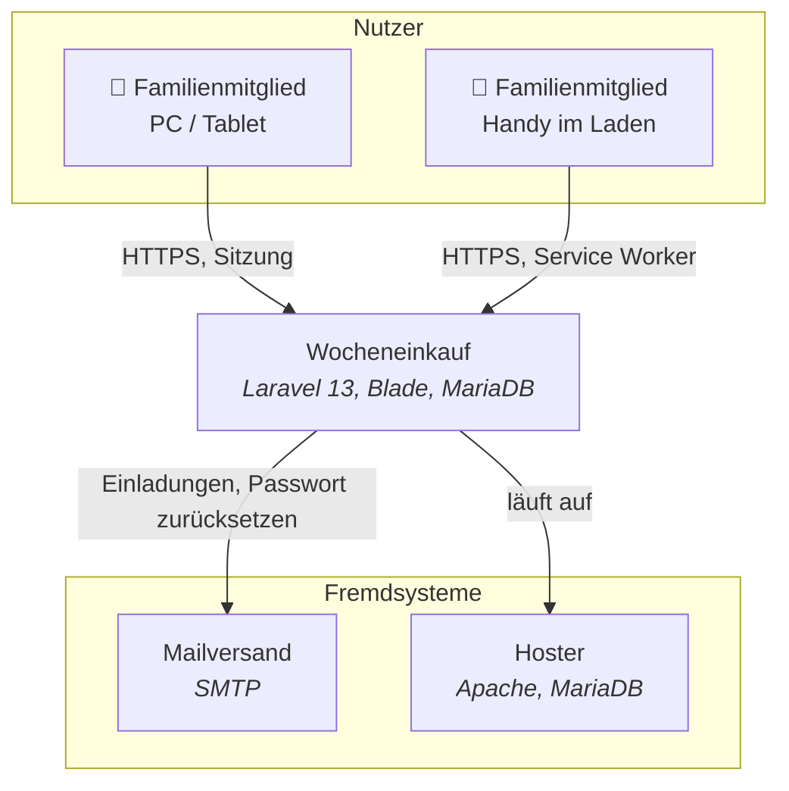

Bewusst **keine** Fremdsysteme darüber hinaus: keine Analyse, kein Tracking, keine Schriften von Dritten, kein Content Delivery Network. Jede zusätzliche Verbindung wäre ein Absatz mehr in der Datenschutzerklärung und ein Ausfallgrund mehr im Betrieb.

---

## 3 · Bausteinsicht

### 3.1 Pakete

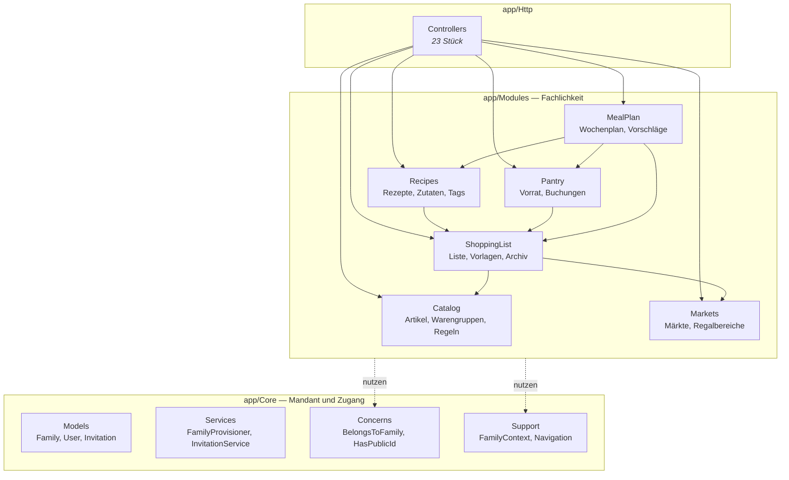

Die Pfeilrichtung ist die Aussage: **Die Einkaufsliste kennt niemanden, der sie befüllt.** Rezept, Vorrat und Wochenplan hängen von ihr ab, nicht umgekehrt. Deshalb landet jede Übernahme durch dieselbe Tür (`ShoppingListManager::addOrMerge`) und wird dort zusammengeführt statt gedoppelt — ohne dass die Liste wissen müsste, dass es Rezepte gibt.

### 3.2 Die Module

| Modul | Aufgabe | Kernklassen |
|---|---|---|
| **Core** | Familie, Konten, Einladungen, Mandantenkontext | `FamilyProvisioner`, `FamilyContext`, `FamilyScope`, `BelongsToFamily` |
| **Catalog** | Artikelkatalog, Warengruppen, automatische Einsortierung | `ProductCategorizer`, `ProductMerger`, `StarterDataInstaller` |
| **Markets** | Märkte und Regalbereiche in Laufreihenfolge | `Market`, `MarketSection` |
| **ShoppingList** | Liste, Freitexterkennung, Sortierung, Archiv, Vorlagen, Abgleich | `ShoppingListManager`, `ItemTextParser`, `ListSorter`, `ListArchiver`, `ListSnapshot` |
| **Recipes** | Rezepte, Zutaten, Schlagworte, Übernahme auf die Liste | `RecipeToList` |
| **Pantry** | Bestand, Buchungen, Fehlmengen | `PantryManager`, `ShortfallToList` |
| **MealPlan** | Wochenplan, Vorschlagsgenerator, Übernahme auf die Liste | `MealPlanManager`, `SuggestionEngine` |

### 3.3 Schichten innerhalb eines Moduls

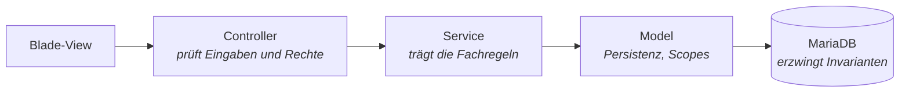

Der Controller entscheidet nichts Fachliches. Er nimmt entgegen, prüft und gibt weiter — deshalb sind die Fachregeln einzeln testbar, ohne HTTP.

---

## 4 · Klassendiagramme

### 4.1 Mandant und Zugang

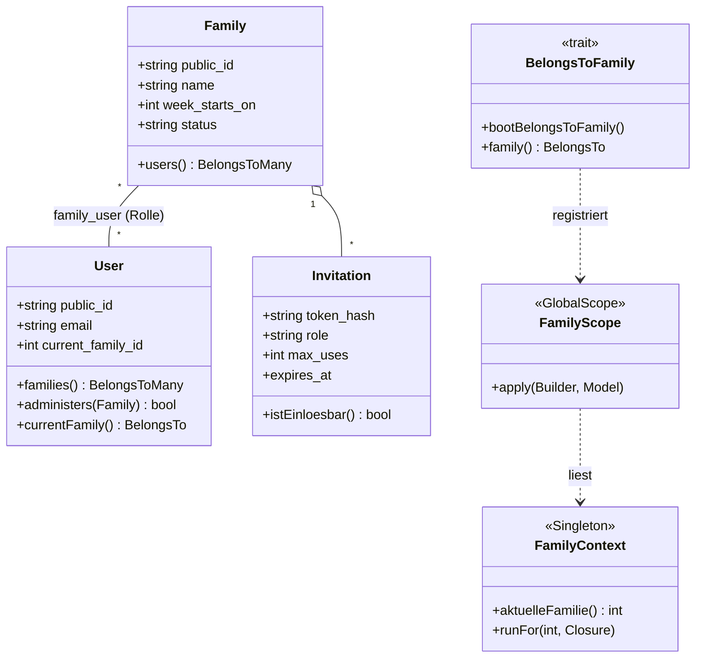

`FamilyContext` ist ein Singleton je Anfrage. Der Global Scope und die Controller müssen dieselbe Familie sehen — zwei Quellen wären ein Sicherheitsloch mit Ansage.

### 4.2 Einkaufsliste

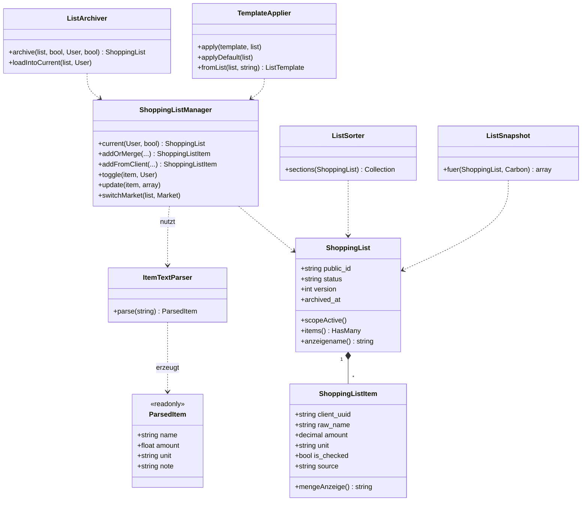

### 4.3 Rezepte

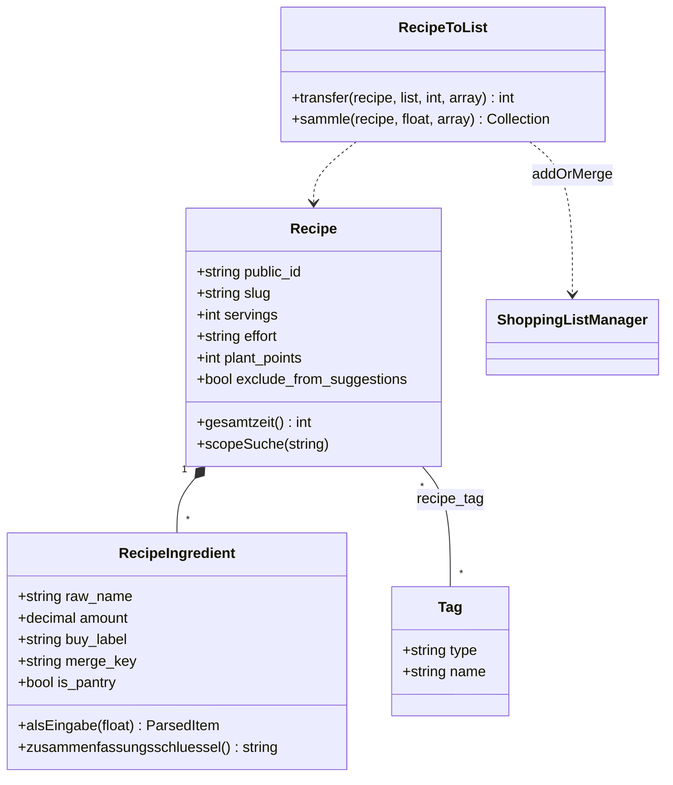

### 4.4 Vorrat

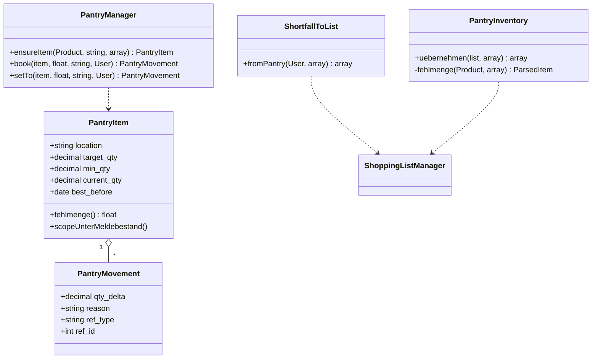

`PantryInventory` gehört zum Modul ShoppingList, nicht zu Pantry: Die Bestandsaufnahme liest die **Sollmenge am Artikel** (`products.pantry_target_amount`) und schreibt auf die Einkaufsliste. Sie rührt den Vorrat nicht an und braucht deshalb auch keine eigenen Tabellen.

### 4.5 Wochenplan

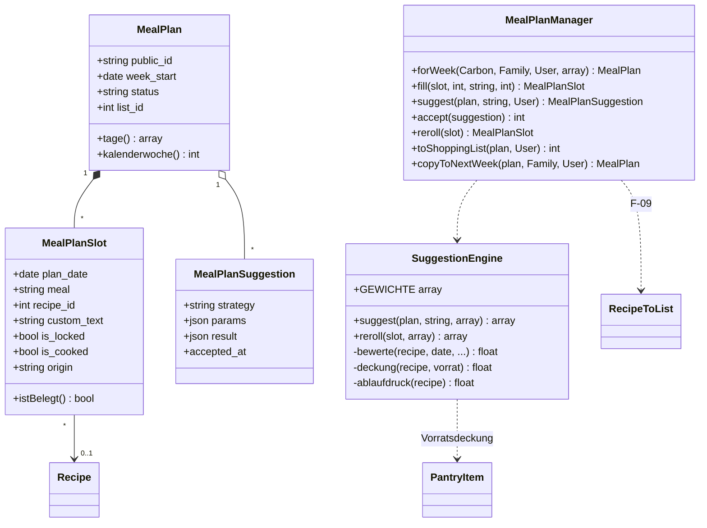

---

## 5 · Ablaufsicht

### 5.1 Artikel aufschreiben (C-01, C-17)

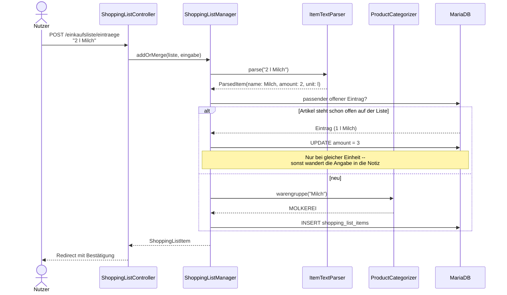

### 5.2 Abgleich zwischen Geräten mit Versionskonflikt (C-07, C-08)

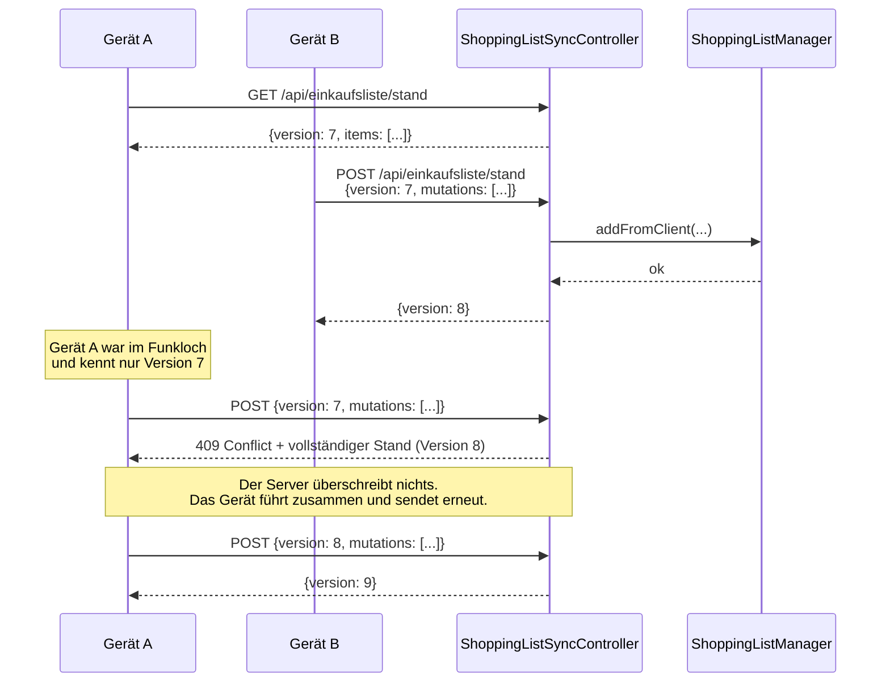

Jede Änderung trägt eine `client_uuid`. Kommt sie zweimal an — der Normalfall nach einem Verbindungsabbruch —, erkennt der Server das und tut nichts. Zusammengeführte Einträge bleiben als weich gelöschte Zeile stehen („Grabstein"), damit ein später eintreffender Wiederholversuch nicht doch noch eine zweite Zeile erzeugt.

### 5.3 Einkauf abschließen (C-11 und Zusatzfunktion)

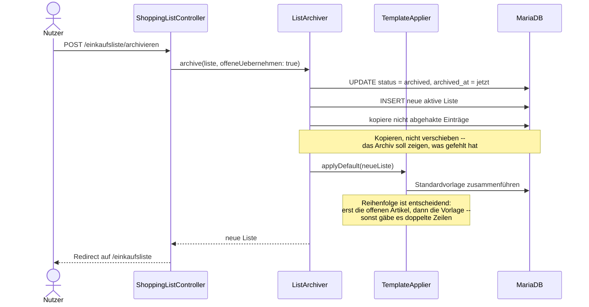

### 5.4 Wochenplan auf die Einkaufsliste (F-09)

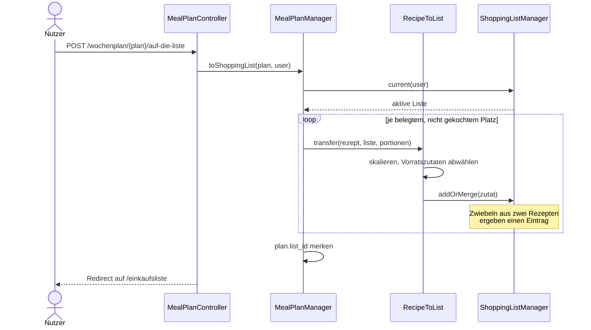

### 5.5 Bestandsaufnahme des Grundvorrats (E-09)

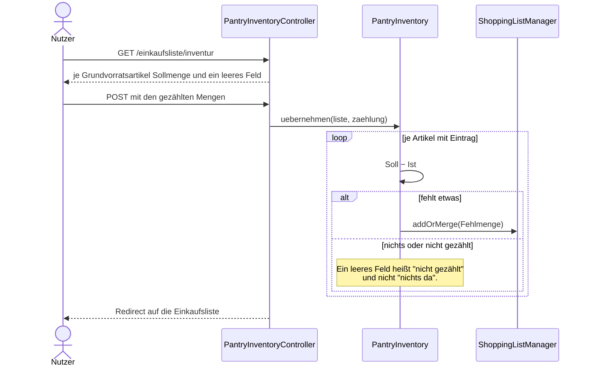

---

## 6 · Zustandsdiagramme

### 6.1 Einkaufsliste

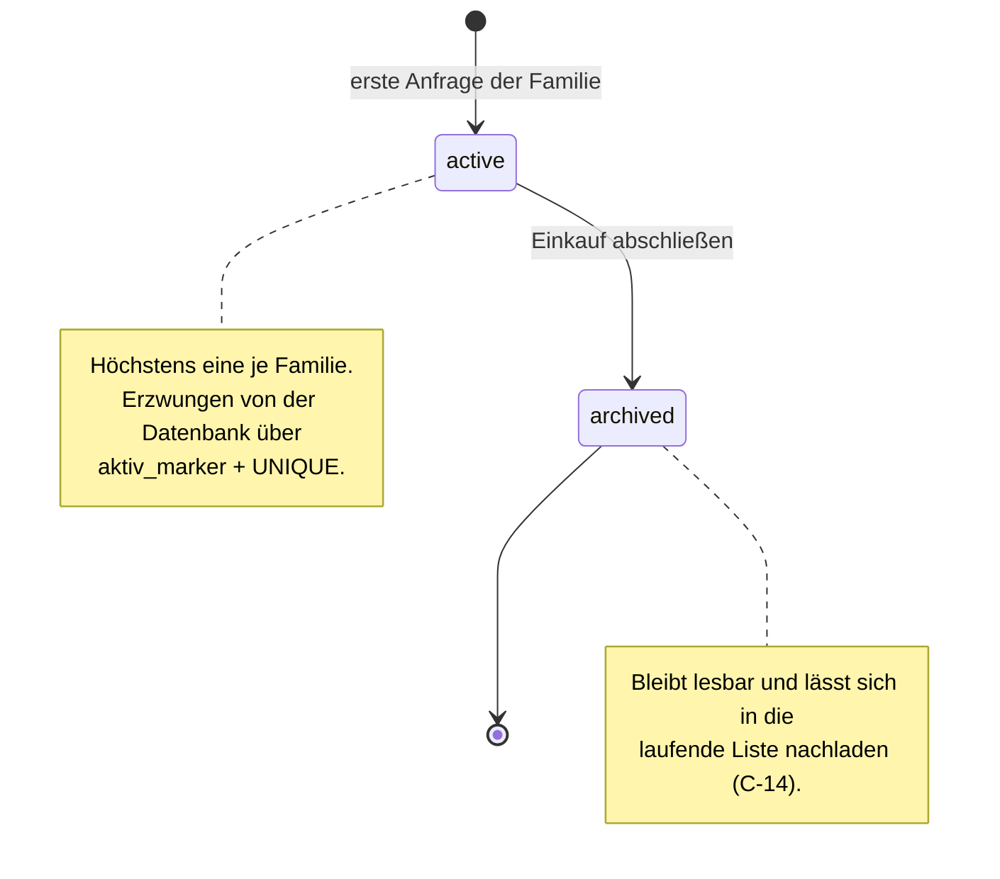

### 6.2 Platz im Wochenplan

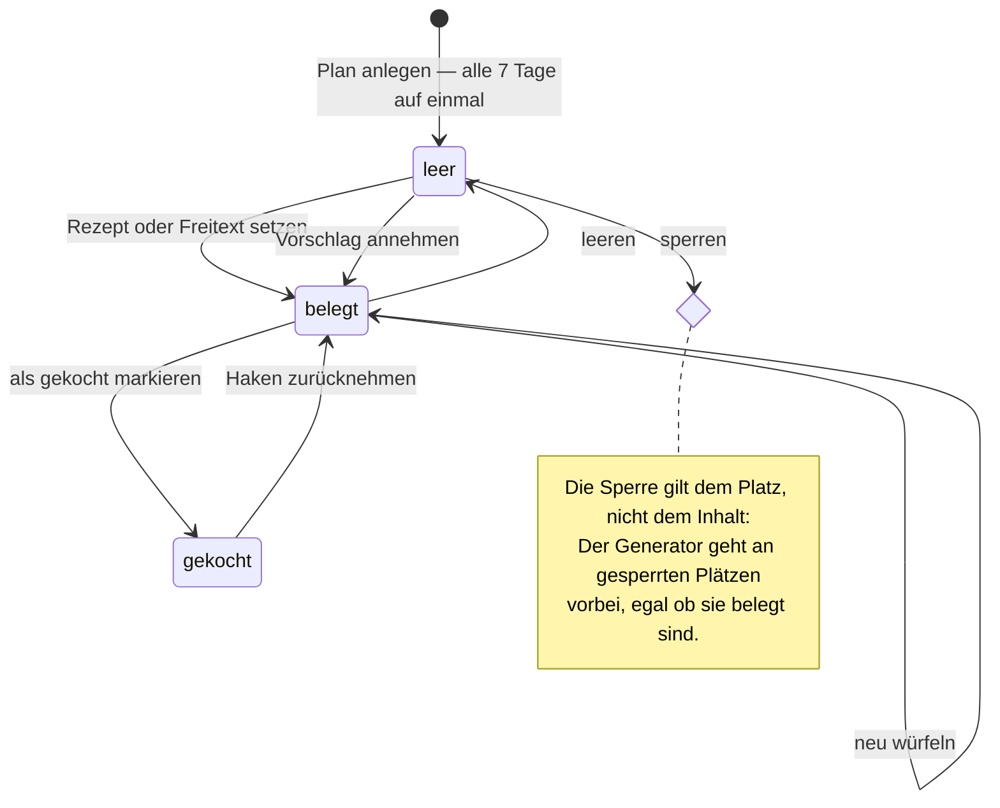

### 6.3 Einladung

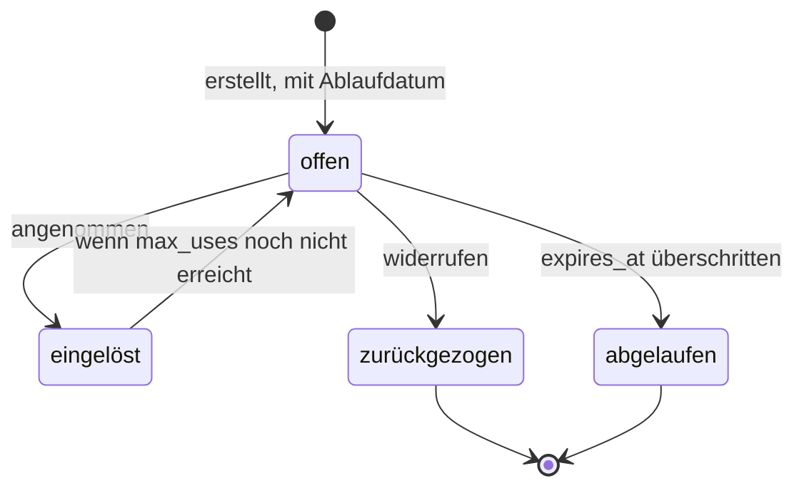

---

## 7 · Querschnittsthemen

### 7.1 Mandantentrennung — drei Ebenen

Die eine Eigenschaft, die nicht kaputtgehen darf. Deshalb hängt sie nicht an einer einzelnen Vorkehrung:

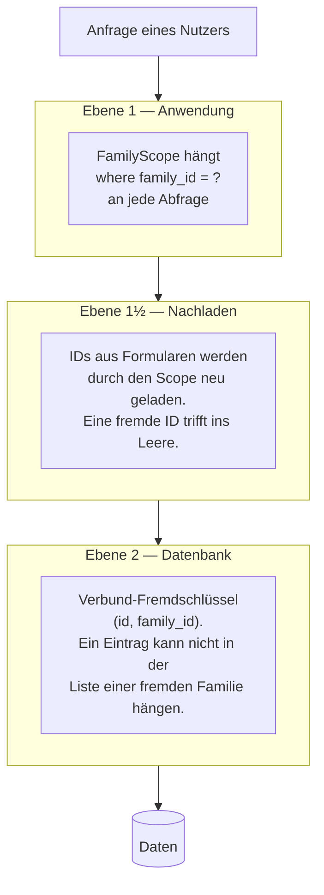

Ebene 1 fängt Vergesslichkeit ab, Ebene 1½ fängt manipulierte Formulare ab, Ebene 2 fängt Fehler in Ebene 1 und 1½ ab. Jede Ebene für sich wäre eine vertretbare Lösung; erst zusammen sind sie eine, bei der ein einzelner Fehler keine fremden Daten sichtbar macht. Sechs Tests prüfen ausdrücklich, dass fremde Zugriffe in 404 enden.

### 7.2 Was die Datenbank selbst durchsetzt

| Zusage | Umsetzung |
|---|---|
| Eine aktive Einkaufsliste je Familie | `aktiv_marker` (generiert) + UNIQUE |
| Kein Eintrag in fremder Liste | Verbund-Fremdschlüssel `(list_id, family_id)` |

Der Grund ist immer derselbe: Zwei gleichzeitige Anfragen können eine Prüfung im Code unterlaufen — „gibt es schon eine aktive Liste?" ist zwischen Frage und Antwort nicht mehr wahr. Ein UNIQUE ist es.

### 7.3 Offlinebetrieb

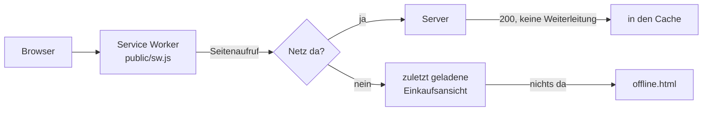

Zwei Entscheidungen stecken darin:

- **Erst Netz, dann Speicher.** Andersherum wäre schneller, aber eine Einkaufsliste von gestern ist schlimmer als eine, die eine Sekunde braucht.
- **Weiterleitungen kommen nicht in den Cache.** Läge die Anmeldeseite einmal unter der Adresse der Einkaufsliste, führte jeder weitere Aufruf offline dorthin — eine Falle, aus der man ohne Netz nicht mehr herauskommt.

Abhaken braucht weiterhin Empfang. Das Warteschlangen-Verfahren für Offline-Änderungen gehört zum Sync-Frontend (Abschnitt 5.2), dessen Endpunkte seit Schritt 4 bereitstehen.

### 7.4 Oberfläche und Geräte

Die Anwendung unterscheidet drei Seitenarten, und sie sagt es dem Nutzer:

| Art | Beispiele | Kennzeichnung |
|---|---|---|
| **PC** | Artikelkatalog, Warengruppen, Märkte, Vorlagen | grauer Streifen, Marke „🖥 Für den PC" |
| **PC + Tablet** | Einkaufsliste, Wochenplan, Rezepte, Vorrat | grüner Streifen, Marke „▤ PC und Tablet" |
| **Handy** | Einkaufsansicht `/einkaufsliste/einkaufen` | eigenes Layout, Marke „▯ Fürs Handy" |

Quelle ist `App\Core\Support\Navigation` — dieselbe Klasse baut das zweistufige Menü und die Kennzeichnung. Zwei getrennte Listen wären nach der zweiten Änderung auseinandergelaufen.

Der erklärende Satz („Diese Seite wird am PC gepflegt …") erscheint per Media Query **nur dort, wo er gebraucht wird**: auf einem Bildschirm, für den die Seite nicht gebaut ist. Am PC wäre der Hinweis „für den PC" nur Lärm.

### 7.5 Kein JavaScript-Framework

Die Anwendung kommt ohne Vue, React oder Livewire aus. Formulare sind Formulare, Antworten sind Weiterleitungen. Das ist keine Nostalgie, sondern folgt aus dem Einsatzort: Im Supermarkt zählt die erste Anzeige, und die ist ohne 200 kB Framework schneller da. Der einzige nennenswerte Skriptcode ist der Service Worker.

### 7.6 Sicherheit

| Thema | Umsetzung |
|---|---|
| Passwörter | bcrypt, Klartext existiert nirgends |
| Sitzungen | in der Datenbank, damit Abmelden sofort überall gilt |
| CSRF | Laravel-Token auf jedem Formular |
| Brute Force | `login_attempts` + Sperre nach mehreren Fehlversuchen |
| Einladungen | nur der Token-Hash liegt in der Datenbank |
| Rechte | Strukturdaten nur Owner und Admin (`requireAdmin`), Alltagsdaten jedes Mitglied |
| IDs nach außen | ULIDs statt laufender Nummern |

---

## 8 · Verteilung

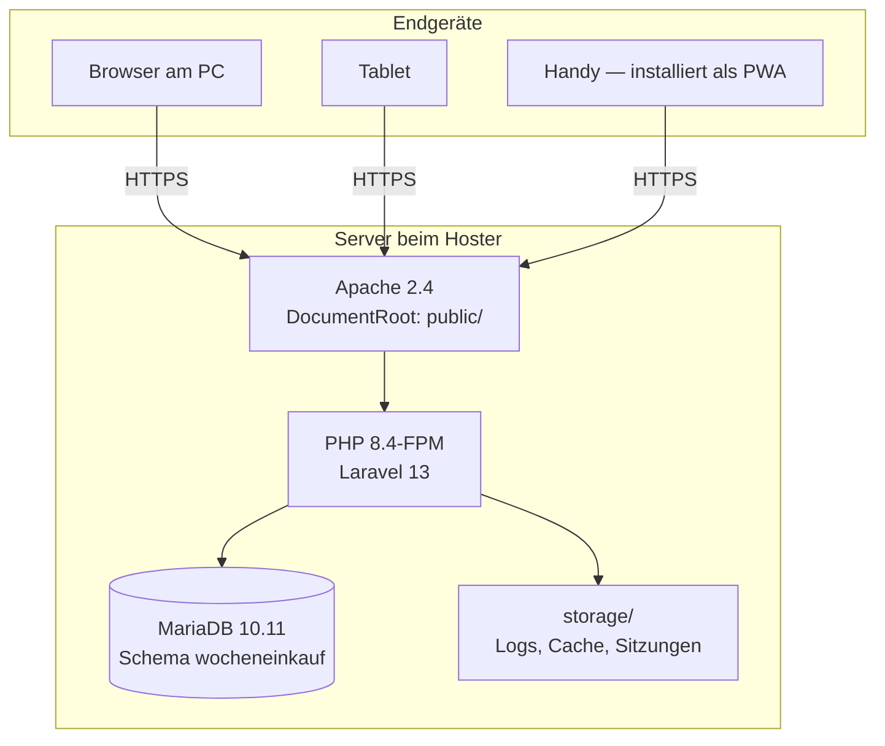

**Betriebsüberwachung:** `GET /health` antwortet mit `200 ok` oder `503 degraded` und meldet Datenbankverbindung sowie Migrationsstand. Offene Migrationen bedeuten: Der Code ist neuer als das Schema — ein Deployment, das nur halb durchgelaufen ist.

**Verzeichnisfalle beim Betrieb mit Apache:** Die App-Symbole liegen unter `public/symbole/` und nicht unter `public/icons/`. Apache bringt in `mods-enabled/alias.conf` ein `Alias /icons/` auf sein eigenes Symbolverzeichnis mit; der Alias greift vor dem Dateisystem, die Symbole wären also unsichtbar, ohne dass am Projekt etwas falsch wäre.

---

## 9 · Getroffene Entscheidungen

| # | Entscheidung | Warum so | Preis |
|---|---|---|---|
| 1 | Laravel statt eigenem PHP | Mandanten, Rechte, Migrationen, Tests sind gelöste Probleme | Rahmenwerk muss gepflegt werden |
| 2 | Mandantentrennung dreifach | Ein einzelner Fehler darf keine fremden Daten zeigen | Mehr Fremdschlüssel, längere Migrationen |
| 3 | Generierte Spalten für Invarianten | Nebenläufigkeit lässt sich im Code nicht sicher prüfen | An MariaDB/MySQL gebunden |
| 4 | Weiches Löschen bei Listeneinträgen | Der Abgleich muss Löschungen mitbekommen | Abfragen müssen `deleted_at` beachten |
| 5 | Regelbasierter Vorschlagsgenerator statt KI | Millisekunden, testbar, erklärbar | Weniger überraschend |
| 6 | Kein JS-Framework | Erste Anzeige im Funkloch | Kein optimistisches Aktualisieren im Frontend |
| 7 | Eigene Ansicht fürs Handy statt responsiver Liste | Im Laden zählt nur Abhaken | Zwei Ansichten zu pflegen |
| 8 | Artikelkatalog als gemeinsame Klammer | Liste, Rezept und Vorrat müssen dasselbe meinen | Mehr Verweise beim Anlegen |
| 9 | Deutsche Fachbegriffe im Code | Die Fachsprache der Nutzer ist deutsch | Gemischtsprachiger Code |

---

## 10 · Qualität

| Kennzahl | Wert |
|---|---|
| Tests | 301 (Feature und Unit) |
| Zusicherungen | rund 1.240 |
| Testdatenbank | echtes MariaDB, kein SQLite — generierte Spalten und Verbundschlüssel gäbe es dort nicht |
| Codeformat | Laravel Pint, Standard `laravel` |
| Laufzeit der Testreihe | rund 140 Sekunden |

Getestet wird ausdrücklich auch das, was **nicht** passieren darf: fremde Datensätze enden in 404, die zweite aktive Liste scheitert an der Datenbank, die Bestandsaufnahme rührt den Vorrat nicht an, ein ausgeschlossenes Rezept taucht in keinem Vorschlag auf.

```bash
php artisan test          # ganze Reihe
./vendor/bin/pint         # Format
php scripts/db-doku.php   # Datenbankdokumentation neu erzeugen
```

---

## 11 · Was noch offen ist

| Thema | Stand |
|---|---|
| Import aus `data.js` (Schritt 5) | wartet auf die Datei |
| Offline-Warteschlange fürs Abhaken | Endpunkte stehen, Frontend fehlt |
| Barcode-Erfassung im Vorrat (E-12) | KANN, nicht gebaut |
| Rezept-Import aus URL (D-09) | KANN, nicht gebaut |
| AV-Vertrag, Löschkonzept, juristische Prüfung | außerhalb des Codes |
